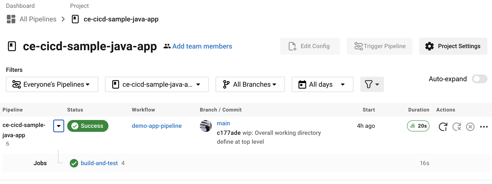
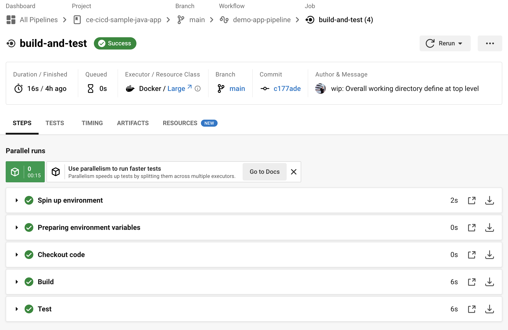

### Setting up the project

In CircleCI you define your pipeline using a YAML file called **config.yml** and it should be placed within the **.circleci** directory.

We've already set you up with a starter config file that will build the application and then run the tests you can [explore the file](./.circleci/config.yml) within the .circleci directory.

Whilst within CircleCI navigate to the **Projects** section.

Filter the projects to show the **ce-cicd-sample-java-app** project and click the **Set up project** button.

In the resulting dialog, type **main** for the branch name and choose the **Fastest** option so that it automatically picks up your config.yml file.

This will then begin to build the application.

Let the build complete and it should hopefully go green 🤞 and look similar to the image below.

Go ahead and explore CircleCI and click into your build to see the steps

Notice that the pipeline is building the Java application and running the Java unit tests. Explore the logs by navigating into the workflow and clicking the **build-and-test** job. You should see something similar to the image below

